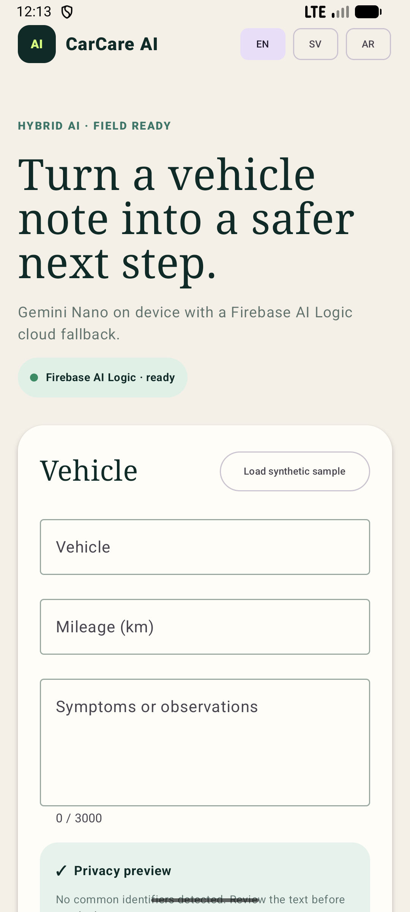
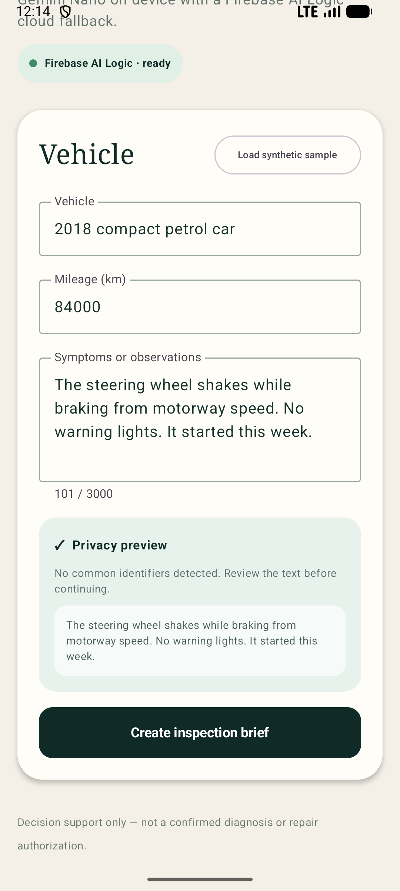
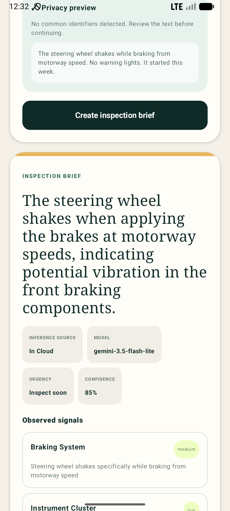

# CarCare AI Field Assistant

CarCare AI Field Assistant helps workshop staff decide what to check before proposing extra work. It previews locally masked text, separates the intake note from the technician's observation, and turns those notes into a structured inspection brief. The Web and native Android apps support Arabic, Swedish, and English.

Built for **Google #BuildHybridAI 2026** with Firebase AI Logic.

**Live web app:** [carcare-ai-field-assistant.web.app](https://carcare-ai-field-assistant.web.app)

**Demo video:** [Watch the workshop evidence review, local and cloud routing, and native Android demo on YouTube](https://youtu.be/Xzp_eaj-8P4)

**Devpost submission:** [CarCare AI Field Assistant](https://devpost.com/software/carcare-ai-field-assistant) — submitted to #BuildHybridAI 2026 on November 18, 2026.

The hosted app has verified `ON_DEVICE` results in Chrome for a general inspection brief and [the seat-mark evidence review](docs/ON_DEVICE_VERIFICATION.md#seat-mark-evidence-review-in-chrome). Native Android has a verified cloud result. See the [verification record](docs/ON_DEVICE_VERIFICATION.md) and the prepared [Devpost cover and gallery images](demo/media/README.md).

## Try the evidence workflow

1. Open the [public review](https://carcare-ai-field-assistant.web.app/?review=quote&lang=en) and select **Load fictional seat-mark example**. For local inference on supported desktop Chrome, select **Prepare hybrid AI** and wait for the model-ready status.
2. Leave the technician note empty and select **Check what evidence is missing**. The report asks for a technician observation and defers service suggestions.
3. Add `The fabric is intact. The mark is a surface stain on the passenger seat cushion, with no visible tears.` and select **Update report with evidence**. Check how the report distinguishes the intake from the technician's observation. Read the inference source displayed on each report.

The [workshop walkthrough](docs/ON_DEVICE_VERIFICATION.md#workshop-seat-inspection-in-chrome) shows both stages on the same real seat case using anonymized notes. The [workshop report](docs/FIELD_PILOT.md#workshop-walkthrough-results) records the operator's estimates, the test quote and the measurement limits.

<p align="center">
  
  
  
</p>

## Why hybrid AI belongs in the field

Workshops can use the same evidence-review workflow on a compatible workstation or a device without a local model. The app uses Firebase AI Logic [`PREFER_ON_DEVICE`](https://firebase.google.com/docs/ai-logic/hybrid/web/get-started#step_5_initialize_the_service_and_create_a_model_instance).

| Route | When it runs | Verified in this project |
| --- | --- | --- |
| `ON DEVICE` | Gemini Nano handles the request locally when the device can run it. On desktop Chrome, the installed model can run without sending the prompt to a cloud model. | Both stages of the [workshop seat case in Chrome](docs/ON_DEVICE_VERIFICATION.md#workshop-seat-inspection-in-chrome). |
| `IN CLOUD` | Firebase AI Logic falls back to a cloud Gemini model when the request cannot run locally. The fallback keeps the workflow usable on devices without a ready local model, when connected. | [Web and native Android cloud runs](docs/VERIFICATION.md). |

The report shows the source returned by the SDK. Both routes use the same report schema and evidence-review workflow. Before inference, **Privacy preview** shows the text after common identifiers have been masked on the device. The initial review in evidence mode withholds service suggestions until a technician observation is supplied. Workshop staff review the result and decide what belongs in a price proposal.

The app:

- never claims a confirmed diagnosis, price, sensor reading, or completed repair;
- provides an optional Geoapify workshop lookup that is separate from AI inference;
- includes a clearly labelled synthetic demo path for UI review without credentials.

## Repository layout

```text
android/   Native Kotlin + Jetpack Compose Android app
web/       React + TypeScript progressive web app
shared/    Public report schema and synthetic sample cases
docs/      Architecture, privacy, contest, and delivery evidence
demo/      Three-minute video script and recording checklist
scripts/   Public-release safety checks
```

## Quick start: web

Requirements: Node.js 24.12 or newer and Chrome 139 or newer for on-device inference.

```bash
cd web
cp .env.example .env.local
npm ci
npm run dev
```

Populate the Firebase values in `.env.local`, configure Firebase AI Logic with the Gemini Developer API, and register a Web App Check provider. For local development, set `VITE_FIREBASE_APP_CHECK_DEBUG=true`; register the printed debug token in Firebase Console rather than committing it.

The UI can be reviewed without Firebase by setting `VITE_SYNTHETIC_DEMO=true`. That mode is visibly labelled and is not evidence of a live AI call.

## Quick start: Android

Requirements: JDK 17, Android SDK 36, and a recent Android Studio.

1. Register the Android application ID `org.carcare.fieldassistant` in the same Firebase project. The Kotlin namespace remains `ai.carcare.fieldassistant`.
2. Download its `google-services.json` to `android/app/google-services.json`.
3. Enable Firebase AI Logic and App Check. Use the debug provider only for local development.
4. Build:

```bash
cd android
./gradlew testDebugUnitTest assembleDebug
```

Gemini Nano requires a supported Android device and the current AICore developer-preview prerequisites. Unsupported devices use the configured cloud fallback through the same Firebase AI Logic SDK.

## Verification

```bash
cd web
npm run check
npm run test:coverage
npm run build

cd ../android
./gradlew testDebugUnitTest assembleDebug

cd ..
node scripts/verify-public-safety.mjs
```

See [docs/VERIFICATION.md](docs/VERIFICATION.md) for the dated test record, [docs/CONTEST_COMPLIANCE.md](docs/CONTEST_COMPLIANCE.md) for the submission gate, and [demo/VIDEO_SCRIPT.md](demo/VIDEO_SCRIPT.md) for the three-minute English demo.

## Safety scope

This is a decision-support prototype, not a diagnostic device. It does not read OBD data, inspect a vehicle, verify repairs, estimate prices, or replace a qualified mechanic. If the report says to stop driving, the driver should move to a safe location if possible and contact roadside assistance or a qualified professional.

## Clean-room status

This is an independent public project created during the contest period. It contains no commercial Car Care source code, customer records, production configuration, private API contracts, or credentials. The clean-room record is in [docs/CLEAN_ROOM.md](docs/CLEAN_ROOM.md).
